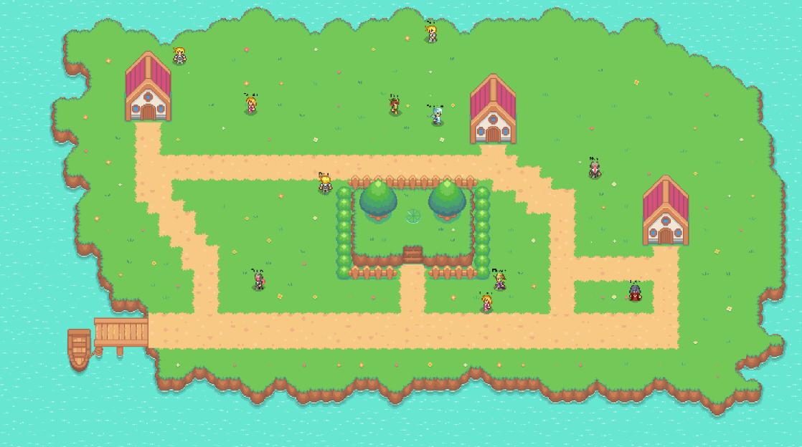

# Aumentando a interatividade e imersão de jogos eletrônicos do gênero RPG com modelos de linguagem de larga escala



Este repositório contém os arquivos do jogo RPG eletrônico desenvolvido para o artigo "[Aumentando a interatividade e imersão de jogos eletrônicos do gênero RPG com modelos de linguagem de larga escala](https://drive.google.com/file/d/132QPNaj88PNbER_lAMox8-WD4rPueuEo/view?usp=sharing)", que se trata de um Trabalho de Conclusão de Curso do curso de Ciência da Computação da Universidade Federal de Campina Grande. O jogo se trata de uma prova de conceito de um RPG eletrônico integrado com um modelo de linguagem visando aumentar a interatividade e imersão dos jogadores. Logo abaixo, é descrito o passo a passo para configurar e rodar o jogo na sua máquina local.

## Requisitos

- Node v20.12.1 (Apenas testado com essa versão)
- npm 10.8.2
- Docker (opcional)
- Banco de dados Redis (opcional se possuir o Docker)

## Instalação

```bash
# Clone o repositório
$ git clone https://github.com/marcossilvaxx/dinamic-rpg.git

# Acesse o diretório do projeto
$ cd ./dinamic-rpg

# Acesse o diretório do frontend
$ cd frontend/

# Instale as dependências
$ npm install

# Acesse o diretório do backend
$ cd ../backend/

# Instale as dependências
$ npm install
```

## Dica: Rodando o banco de dados Redis utilizando o Docker

```bash
# Crie o container do banco de dados Redis utilizando a imagem oficial do Redis

$ docker run --name redis-game -p 6379:6379 -d redis
```

## Configuração

Renomeie o arquivo `env.example.json` localizado no diretório `backend/` para `env.json` e preencha os valores para `OPENAI_API_KEY` e `OPENAI_PROJECT_ID` com sua chave de API da OpenAI e o id do seu Projeto da OpenAI (que pode ser encontrado acessando o link: https://platform.openai.com/organization/projects). Em seguida, altere o valor de `REDIS_HOST` e `REDIS_PORT` para o host e porta do seu banco de dados Redis. Qualquer valor também pode ser definido por variável de ambiente com o mesmo nome.

```javascript
{
  "OPENAI_API_KEY": "",
  "OPENAI_PROJECT_ID": "",
  "REDIS_HOST": "localhost",
  "REDIS_PORT": 6379
}
```

Configurações opcionais (com seus valores padrão):

| Chave | Padrão | Descrição |
| --- | --- | --- |
| `MODEL` | `gpt-6-luna` | Modelo da OpenAI utilizado (o mais barato da geração atual: US$ 0,10 / 0,50 por milhão de tokens de entrada/saída) |
| `REASONING_EFFORT` | `none` | Esforço de raciocínio do modelo. Use `""` para modelos sem raciocínio, como o `gpt-4o-mini` |
| `PORT` | `8080` | Porta do servidor websocket |
| `RESET_DB_ON_START` | `false` | Apaga o banco Redis ao iniciar o backend (inclusive as partidas salvas) |
| `MAX_MEMORY_MESSAGES` | `40` | Quantidade de mensagens lembradas por cada NPC |
| `MAX_NPCS` | `12` | Quantidade máxima de NPCs por partida |
| `DIALOG_TEMPERATURE` | `0.7` | Temperatura dos diálogos (valores menores deixam as falas mais diretas e coerentes) |
| `PROMPT_CACHE` | `true` | Marca o contexto do mundo para o cache de prompt da OpenAI (modelos GPT-5.6+). Use `false` para modelos mais antigos |
| `LOG_LLM_USAGE` | `true` | Mostra no console os tokens de cada chamada, incluindo os lidos do cache |
| `WORLD_EVENT_INTERVAL_MS` | `300000` | Intervalo entre eventos do mundo (mínimo de 30 s). Use `0` para desativar |
| `MS_PER_GAME_MINUTE` | `1000` | Velocidade do relógio do jogo (1000 = 1 segundo real por minuto; o dia dura 24 minutos) |
| `SESSION_GRACE_MS` | `1800000` | Por quanto tempo a partida fica na memória depois que o jogador sai (depois disso ela continua salva no Redis) |
| `SESSION_TTL_DAYS` | `7` | Partidas salvas que não forem jogadas por esse número de dias são apagadas do Redis (`0` mantém para sempre) |
| `DAYS_PER_SEASON` | `2` | Quantos dias do jogo dura cada estação do ano |
| `MAX_NPC_FACTS` | `20` | Quantidade de fatos (coisas que ouviu/aprendeu) lembrados por cada NPC |

Além disso, também renomeie o arquivo `env.example.json` encontrado no diretório `frontend/src/config/` para `env.json` e preencha `WEBSOCKET_SERVER_URL` com a url do servidor backend, que, por padrão, já está definido como `ws://localhost:8080`.

```javascript
{
  "WEBSOCKET_SERVER_URL": "ws://localhost:8080"
}
```

No arquivo `constants.js` encontrado no mesmo diretório, é possível escolher a quantidade de NPCs a serem gerados alterando o valor da constante `NUMBER_OF_NPCS`. Obs: É importante lembrar que quanto maior a quantidade de NPCs, mais demorado é o carregamento inicial do jogo.

```javascript
export const NUMBER_OF_NPCS = 5;
```

## Rodando o jogo

Após realizar as etapas de instalação e configuração, execute o seguinte comando em ambos os diretórios `frontend/` e `backend/`:

```bash
$ npm run dev
```

Em seguida acesse http://localhost:5173/ para iniciar o jogo. Divirta-se!

## Vida na vila

O jogo já roda enquanto o mundo é gerado: o mapa aparece na hora, e os moradores chegam à vila conforme são criados.

**Rotinas:** o mapa tem lugares definidos (taverna, armazém, píer, jardim...), em `frontend/src/levels/places.js`. A história do mundo é escrita em torno deles, e cada NPC ganha uma ocupação e uma rotina de 2 ou 3 lugares, por onde circula ao longo do tempo.

**Guiar e apresentar:** no chat, peça a um NPC para levar você a um lugar ("me leva ao píer?") ou para apresentar outro morador. Ele vai andando e espera se você ficar para trás.

**Eventos do mundo:** de tempos em tempos acontece algo na vila (um mercador chegou, uma cabra fugiu...). A notícia aparece no topo da tela, e todos os NPCs passam a comentá-la.

**Clima:** o tempo muda ao longo do dia: céu limpo, nublado, chuva, tempestade (com raios e trovões) ou neblina pela manhã. Na chuva, os moradores procuram abrigo na taverna ou em casa, e o clima entra nas conversas.

**Festas da vila:** todo dia, às 9h, é anunciado o evento do fim da tarde (feira, competição, dança, reunião...). Das 17h às 19h a vila inteira se reúne no lugar marcado (ou na taverna, se estiver chovendo) e os moradores conversam mais entre si. Depois, todos lembram da festa.

**Trabalho:** no local de trabalho, durante o expediente, cada morador mostra um ícone do que está fazendo (forja, pesca, cozinha...). Alguns vendem coisas do seu ofício, e o preço muda com a sua reputação: mais barato para quem é querido, mais caro para quem não é.

**Estações do ano:** primavera, verão, outono e inverno se alternam a cada 2 dias do jogo. No inverno neva e a comida fica mais cara, no verão quase não chove, e no outono os preços da colheita caem. O primeiro dia de cada estação tem uma festa própria, e a tela muda de tom.

**Economia:** cada morador tem um estoque que acaba e é reposto toda manhã, os moradores compram uns dos outros, e eventos (uma tempestade, falta de farinha) sobem ou baixam os preços de alguém. Você também pode vender o que tem aos moradores.

**Combate:** **Espaço** ataca na direção em que você está virado, **Shift** dá um passo rápido para trás (esquiva) e **H** usa o item que mais cura (poções, remédios, ervas, comida). O estilo de cada um vem do personagem e da profissão: guerreiros batem forte, ninjas são rápidos e esquivam, arqueiros e magos atacam de longe, curandeiros se curam uma vez. Antes de cada golpe o oponente mostra um "!", que é a hora de esquivar. Armas e armaduras que você carrega (espada, adaga, escudo, armadura...) aumentam seu dano e sua vida.

- **Treino:** peça a um morador para treinar ("vamos treinar?"). Quem estiver perdendo desiste, ninguém se machuca e vocês ficam mais próximos.
- **Duelos e brigas:** um rival pode te desafiar para um duelo, e um morador provocado (ou o culpado encurralado) pode partir para cima de você. Nesses casos quem perde desmaia: o morador acorda em casa e fica machucado por algumas horas, e você acorda na taverna, com menos moedas.
- **Bater em alguém:** quem é corajoso revida, quem é tímido foge gritando por socorro. Se a vila tiver um guarda, ele vem separar e te multa. Quem estiver por perto vê a briga, e isso muda o que pensam de você, vira notícia e fofoca.
- **Bandidos:** a cada 3 dias, às 15h, bandidos invadem a vila e os moradores se escondem. Derrote todos para ganhar o que eles deixam cair, a gratidão de todos e o título "Protetor da vila". Se ninguém os impedir, eles roubam as mercadorias de alguém e vão embora.
- Uma chamada ao modelo escreve as provocações de cada oponente e o que ele vai lembrar da luta.

**Pescar e colher:** perto do píer aparece **F - Pescar**, e nos campos **F - Colher**. Aperte F e depois F de novo quando o ponteiro estiver na faixa verde (na dourada é perfeito). O que você encontra muda com a estação, e dá para vender, trocar ou dar de presente.

**Visitantes:** a cada dois dias chega alguém de fora pelo píer (um mercador, um bardo, uma herbalista...), com coisas raras para vender. Fica até as 20h e depois vai embora.

**Vida familiar:** moradores muito próximos começam a namorar, ficam noivos (o casamento vira a festa do dia), se casam, vão morar juntos e têm filhos. Tudo vira notícia.

**Sonhos:** cada morador tem uma meta pessoal, que avança um pouco por dia e mais rápido quando você ajuda. Quando ele realiza, é notícia, e ele passa a sonhar com outra coisa.

**Mapa vivo:** o mapa muda com o tempo e com a história.

- **Dia e noite:** à noite as janelas das casas acendem (e apagam quando todos dormem), os postes iluminam as ruas, a fogueira do jardim é acesa no começo da noite e você carrega uma lanterna. As chaminés soltam fumaça nas refeições e no frio.
- **Estações no chão:** flores na primavera, grama seca no verão, folhas caídas e árvores alaranjadas no outono e grama pálida no inverno. A neve acumula aos poucos no chão, nos telhados e nas árvores, e derrete depois, deixando lama.
- **Chuva:** as estradas viram lama, formam-se poças (com respingos enquanto chove) que secam com o sol, e o moinho gira mais rápido com o vento.
- **Pegadas:** todos deixam pegadas na neve e na lama. Durante um mistério, pegadas de botas ligam dois lugares da vila: examine-as (**F**) antes que uma tempestade as apague, e a pista vai para o diário.
- **Plantação:** o campo perto do moinho cresce ao longo do dia (a chuva ajuda, a tempestade estraga e no inverno a terra descansa). Quando amadurece, você pode colher (**F**) e ajudar o fazendeiro. Uma colheita farta barateia a comida, e uma fraca a encarece.
- **A história no mapa:** a festa do dia monta bandeirinhas, mesa e lanternas (e um arco de flores nos casamentos). Quem realiza um sonho constrói algo perto de casa (barraca, barco, canteiro, oficina ou estandarte). Os bandidos deixam um carrinho virado e caixas quebradas, que você pode consertar (**F**) para ganhar a gratidão da vítima.
- **Objetos (F):** poço (água fresca, que cura um pouco), pilha de lenha, baús escondidos que se reabastecem a cada dois dias, placas que mostram quem está em cada lugar e portas onde você pode bater para saber se alguém está em casa.
- **Bichos e água:** galinhas que fogem de você, um gato que te segue depois de um carinho, pássaros que pousam e voam quando alguém se aproxima, gaivotas, borboletas, vaga-lumes nas noites quentes, peixes pulando perto do píer, ondas na costa e o brilho do sol na água.

**Interiores:** dá para entrar na taverna, no armazém e nas casas (**F** na porta) e sair pelo tapete. Os moradores entram quando chegam ao lugar da rotina: almoçam e passam a noite na taverna, trabalham no balcão do armazém e dormem em casa. A taverna só fecha de madrugada e o armazém abre de dia. Uma casa só abre se tiver alguém acordado lá dentro, a menos que você seja amigo de quem mora lá. Fechada, a porta diz se estão todos dormindo ou onde estão os moradores. Lá dentro: no balcão da taverna dá para pedir uma sopa (3 moedas), no balcão do armazém ver o que está à venda, e na cama descansar (de noite até as 7h, de dia um cochilo de 2h). Um morador que quer falar com você entra no prédio para te encontrar.

**Uma vila planejada pelo modelo:** ao criar o mundo, o modelo de linguagem decide o que construir nos terrenos vazios do mapa (casas, ferraria, enfermaria, padaria...), dá nome a cada construção e escolhe quem mora ou trabalha nela. As casas aparecem no mapa, ganham interior, e a rotina de cada morador começa pela sua casa ou pelo seu trabalho. Cada partida tem uma vila diferente.

**O terreno muda:** onde as pessoas andam muito, a grama se gasta e vira uma trilha de terra, que volta a crescer se ninguém passa. Se ninguém impedir os bandidos, eles podem incendiar a casa da vítima: ela fica fechada, com fumaça e fuligem, até os moradores a reconstruírem (2 dias). Você ajuda levando 2 lenhas (**F** na porta) e ganha a gratidão de quem mora lá. Boas colheitas fazem os moradores abrirem novos canteiros (até 9).

**Viagens de barco:** no píer, **F - Viajar de barco** leva (em meia hora de jogo) a:
- **Floresta Sombria:** árvores para cortar com um machado (viram toco e crescem de novo em 2 dias), arbustos com cogumelos e frutas e o acampamento dos bandidos. Derrotar os vigias libera o baú deles e adia o próximo ataque à vila.
- **Mina do Penhasco:** escura (sua lanterna e as tochas iluminam), com pedras de minério de ferro e carvão e cristais raros, extraídos com uma picareta.
- **Vila de Pedravento:** uma praça com comerciantes que vendem machado, picareta, armas e comida, e compram minério, cristais, lenha e o que você colhe.

Os moradores sabem desses lugares e podem pedir coisas que só se acham lá.

**Interface:** minimapa no canto (**N** mostra ou esconde), nome do lugar ao entrar nele e sons sintetizados: pássaros de dia, grilos à noite, chuva, trovões, passos e a "voz" de cada personagem. **M** liga ou desliga o som. **P** pausa e despausa o jogo: o tempo da vila (relógio, clima, festas, prazos e eventos) para.

## Objetivos e vida da vila

Aperte **J** para abrir o diário, com pedidos, mistério, pessoas, inventário, conversas ouvidas e notícias.

- **Pedidos:** os moradores podem pedir ajuda com problemas concretos, como levar um recado, descobrir algo ou trazer um item. Cumprir um pedido melhora a reputação com quem pediu, e às vezes rende uma recompensa. Pedidos urgentes têm prazo: perto do fim, quem pediu vem te lembrar, e perder o prazo deixa a pessoa decepcionada. Ajudar alguém também irrita os inimigos dessa pessoa.
- **Reputação:** cada morador tem uma opinião sobre você, de -10 a 10, que muda com o que você diz. Grosseria tem consequência: a pessoa responde seco, recusa ajuda e comenta com os outros.
- **Fofoca sobre você:** quando dois moradores falam de você, a opinião de um puxa a do outro. Quem nunca te viu pode já chegar desconfiado, ou curioso para te conhecer.
- **Mistério:** cada vila tem um mistério. Um morador é o culpado, tem um álibi falso e só confessa diante de provas; cada um dos outros sabe uma pista. O diário guarda o que cada um disse sobre o caso (depoimentos), para você comparar e achar as contradições. Um dos moradores guarda uma **prova** física: se ele confiar em você, entrega. Mostrar a prova ao culpado faz ele confessar, e com ela uma acusação errada não gasta tentativa. Você também pode acusar alguém pelo diário (são 2 tentativas).
- **Mistérios em sequência:** algumas horas depois de um caso terminar, aparece outro. Cada caso resolvido rende um título ("Curioso da vila", "Investigador", "Detetive da vila") que os moradores conhecem e respeitam.
- **Segredos e mentiras:** cada morador tem um segredo e mente sobre ele, a menos que confie muito em você.
- **Negociar e subornar:** ofereça moedas ou itens por informações e favores. Pessoas honestas recusam e se ofendem, as gananciosas aceitam.
- **Inventário:** você começa com 10 moedas. Os moradores podem te dar, vender e aceitar itens ou pagamentos.
- **Moradores que te procuram:** quem tem algo a dizer (uma pista, um lembrete, algo que ouviu sobre você) vai atrás de você, com um "!" sobre a cabeça. Ao abrir o chat, quem já te conhece fala primeiro e lembra da última conversa.
- **Dia e noite:** um dia do jogo dura 24 minutos. À noite a tela escurece e os moradores dormem em casa. Nas refeições eles vão à taverna, e à noite parte deles fica por lá. Acordar alguém tem efeito: a pessoa sabe que foi acordada.
- **Humor:** o humor de cada morador muda com as conversas, os eventos e o seu comportamento, e afeta como ele fala.
- **Amizades e brigas:** moradores com afinidade alta viram amigos e se encontram mais. Os que brigam passam a se evitar, com um ícone de raiva. Essas mudanças viram notícia.
- **Memória de longo prazo:** quando um morador acumula fatos demais, os mais antigos viram entradas de um diário em vez de serem esquecidos.
- **Amizade, namoro e rivalidade:** além da reputação, cada morador pode virar seu amigo, melhor amigo, namorado(a) (um de cada vez) ou rival. Cada um adora e detesta certos presentes, e você pode convidar alguém para a festa do dia. Um amigo que anda com você ajuda a convencer os outros a falar.
- **Escolhas com consequência:** quando o culpado confessa, só você sabe. Decida no diário: contar à vila (justiça e título) ou guardar o segredo (um aliado e algumas moedas). Mas o segredo pode vazar, e aí a vila não gosta nada.
- **Brigas para resolver:** quando dois moradores viram inimigos, um deles te pede para ajudar a fazer as pazes. Convença o outro, e os dois voltam a se falar.
- **Partida salva:** o jogo é salvo no Redis o tempo todo. Ao recarregar a página você volta para a mesma vila, mesmo que o backend tenha sido reiniciado.
- **Respostas ao vivo:** a fala do NPC aparece no chat enquanto ele "escreve" (streaming).

## Conversas entre NPCs

Quando dois NPCs se encontram pelo mapa, eles podem conversar entre si. As falas aparecem em balões, e, se o jogador estiver por perto, também num registro no canto da tela e na aba "Conversas" do diário. Os NPCs lembram dessas conversas e do que o jogador contou a eles, e podem espalhar essas informações (fofoca) para outros NPCs e para o próprio jogador. Apertar **E** perto de um NPC que está conversando interrompe a conversa.

**Escutar escondido:** se o jogador está perto o bastante para ouvir, mas longe o bastante para não ser visto, os NPCs acham que estão sozinhos e falam o que pensam de verdade: fofocas, opiniões sobre você e até segredos. O culpado do mistério pode deixar escapar um detalhe. Se você chegar perto demais, eles percebem, mudam de assunto e não gostam de ter sido espionados.

A frequência das conversas é configurada em `NPC_CHAT`, no arquivo `frontend/src/config/constants.js`, e o idioma em `NPC_CONVERSATION_LANGUAGE`. Para ver as conversas, as rotinas e os eventos acontecendo logo no início, acesse http://localhost:5173/?fastNpcChat.

Cada partida é independente: na primeira vez, o backend gera um novo mundo e novos NPCs. Ao recarregar a página, o jogo retoma a mesma partida, que fica salva no Redis por 7 dias sem ser jogada (ver `SESSION_TTL_DAYS`), mesmo que o backend seja reiniciado. Para começar uma vila nova, apague a chave `dinamic-rpg:session` do `localStorage` do navegador (ou abra o jogo numa janela anônima).

## Editando o mapa (Tiled)

O mapa da vila, os interiores e as regiões são desenhados tile a tile a partir dos arquivos do [Tiled](https://www.mapeditor.org/) em `frontend/tiled/` (`game-test-map.tmx`, `interiors/*.tmx` e `regions/*.tmx`; as imagens dos tilesets ficam em `frontend/public/tilesets/`). Depois de editar um mapa no Tiled, gere o arquivo usado pelo jogo:

```bash
# Em frontend/
npm run maps
```

Convenções: a camada `Collisions` define onde não se anda, camadas que começam com `Foreground` são desenhadas por cima dos personagens e, nos interiores, a camada de objetos `Points` tem a entrada (`entrance`), o tapete de saída (`exit`), os lugares onde os moradores ficam (tipo `spot`), os balcões (`counter`), a cama (`rest`) e as luzes (tipo `light`). Nas regiões, `Points` tem a chegada do barco (`arrival`), as árvores (`tree`), as pedras (`ore`), os cristais (`crystal`), os arbustos (`forage`), os comerciantes (`merchant`) e o acampamento (`camp`, `camp_chest`). Os terrenos vazios onde o modelo pode construir estão em `src/levels/decor.js` (`LOTS`).

## Testes e lint

```bash
# Em backend/ ou frontend/
$ npm test
$ npm run lint
```

## Arquitetura

```
backend/
  index.js                 Servidor websocket: cria uma GameSession por conexão e roteia mensagens
  config.js                Configuração (env.json + variáveis de ambiente)
  protocol.js              Tipos de mensagem do websocket
  game/GameSession.js      Núcleo de uma partida: NPCs, memória, relógio, o "tick" do tempo e o
                           salvamento; delega o resto para as partes abaixo
  game/VillageBuilder.js   Criação da vila (história, elenco, planta da vila e NPCs em paralelo)
  game/PlayerChat.js       Chat com o jogador (streaming, saudação, companhia) e ações dos NPCs
  game/NpcSocial.js        Conversas entre NPCs, relações, escuta escondida, fofoca e pazes
  game/Quests.js           Pedidos, prazos e pedidos de paz entre inimigos
  game/Commerce.js         Economia: estoque, preços (estação e eventos), vendas e compras
  game/Bonds.js            Amizade, melhor amigo, namoro e rivalidade com o jogador; presentes e convites
  game/Goals.js            Sonhos (metas pessoais) dos moradores
  game/FamilyLife.js       Namoros, noivados, casamentos, mudanças e filhos
  game/Visitors.js         Visitantes que passam um dia na vila
  game/Activities.js       Pesca e coleta (o que se encontra em cada estação)
  game/Combat.js           Lutas: treino, duelo e briga; testemunhas, guarda, desmaios e ferimentos
  game/combatRules.js      Coragem e reação dos NPCs, guarda da vila e itens que curam
  game/Bandits.js          Ataques de bandidos e o título de protetor da vila
  game/VillageMap.js       Mapa vivo: plantação e colheita, neve e lama, destroços, construções,
                           pegadas do mistério e objetos (poço, lenha, baús)
  game/Terrain.js          Trilhas gastas na grama e casas incendiadas (e a reconstrução)
  game/Regions.js          Floresta, mina e vila vizinha: recursos, acampamento e comerciantes
  game/seasons.js          Estações do ano
  game/NpcConversation.js  Geração da conversa entre dois NPCs
  game/PlayerState.js      Reputação, inventário, pedidos (com prazo), pessoas conhecidas e notícias
  game/Investigation.js    Mistérios em sequência: confissão, prova, depoimentos e título do jogador
  game/Mystery.js          Um mistério (culpado, pistas, prova e acusação)
  game/VillageLife.js      Eventos do mundo, clima, estações e festa do dia (ou casamento)
  game/Weather.js          Transições do clima
  game/festivals.js        Sorteio e horários da festa do dia
  game/hearsay.js          Fofoca sobre o jogador (opinião de um NPC puxa a do outro)
  game/Seeking.js          NPCs que vão atrás do jogador (um por vez, com motivo)
  game/shop.js             Mercadorias dos NPCs e preço conforme a reputação
  game/GameClock.js        Relógio do jogo (pausa quando o jogador sai)
  game/needs.js            Fome, cansaço, sono e humor dos NPCs
  game/cast.js             Validação do elenco (nomes bem diferentes, um por NPC)
  game/worldEvents.js      Sorteio do tipo, lugar e envolvidos de cada evento do mundo
  agents/NpcAgent.js       Diálogo de um NPC com o jogador e sua memória
  agents/npcTools.js       Ferramentas que o NPC pode chamar (seguir, guiar, pedidos, itens, vender,
                           confessar, comprar, mudar a relação, aceitar convite...)
  llm/client.js            Cliente da OpenAI com structured outputs e streaming
  llm/partialJson.js       Lê o texto da fala de um JSON que ainda está chegando
  prompts/                 Prompts de geração do mundo, dos NPCs, de diálogo e de eventos
                           (worldContext.js é o prefixo comum, reaproveitado pelo cache)
  storage/SessionStore.js  Persistência no Redis, separada por partida (com expiração)
frontend/src/
  main.js                  Cena, carregamento e conexão
  net/                     Websocket único do jogo e tipos de mensagem
  objects/                 Hero, Npc, Map, Camera, SpeechBubble, Character (sprites/animações)
  systems/NpcDirector.js   Detecta encontros entre NPCs, reproduz suas conversas e trata a escuta
                           escondida
  systems/time.js          Agenda dos NPCs por hora (sono, festa, chuva, refeições) e iluminação
  systems/WeatherEffects.js Chuva, neve, neblina, céu nublado, relâmpagos e o tom de cada estação
  systems/activity.js      Regras do minijogo de pesca e coleta
  systems/FightManager.js  Lutas em tempo real (ataque, esquiva, cura, IA dos oponentes, bandidos)
  systems/combat.js        Regras das lutas: perfis por classe e profissão, alcance, equipamento
  audio/sound.js           Sons sintetizados com Web Audio (ambiente, passos, vozes, avisos)
  state/                   Estado do jogador, do mundo (clima e festa) e conversas ouvidas
  hud/                     Chat, diário (J), minimapa (N), nome do lugar, pesca/coleta (F),
                           notificações, relógio, conversas ouvidas e faixa de status
  utils/overlay.js         Balões e ícones desenhados por cima das árvores
  levels/places.js         Lugares do mapa usados nas rotinas, encontros e prompts
  levels/maps.js           Mapas exportados do Tiled (gerado por scripts/export-maps.mjs)
  levels/world.js          Vila + interiores numa só grade de colisão
  world/TileMap.js         Desenha um mapa do Tiled tile a tile (e permite trocar tiles)
  world/Interiors.js       Entrar e sair dos prédios, moradores lá dentro, balcões, cama e luz interna
  world/Regions.js         Viagens de barco, floresta, mina e vila vizinha (comércio e acampamento)
  world/VillageLayout.js   Carimba as casas da vila planejada pelo modelo nos terrenos
  hud/ChoiceMenu/          Menu de escolhas (viagem e comércio)
  levels/decor.js          Posições dos objetos do mapa (postes, moinho, poço, baús, plantação...)
  world/Village.js         Mapa vivo: estado do servidor, pegadas, luzes e interações (F)
  world/terrain.js         Lê os pixels do mapa e pré-desenha neve, outono, lama, espuma...
  world/GroundLayer.js     Chão: estações, neve, poças, água, plantação e pegadas
  world/Props.js, sprites.js Objetos e construções desenhados em pixel art (sem imagens)
  world/Ambient.js         Bichos, fumaça, folhas, peixes, borboletas e vaga-lumes
  world/Lighting.js        Escuridão da noite com as luzes da vila
  world/rules.js           Regras puras (horários das luzes, fumaça, vento, bichos)
  utils/collisionGrid.js   Colisão por tiles
  utils/findShortestPath.js, pathfinding.js, pathfindingWorker.js
                           A* executado em um Web Worker compartilhado
```

O design da interação entre NPCs está descrito em [docs/npc-interactions.md](docs/npc-interactions.md).

## Créditos

- Tileset utilizado: https://cypor.itch.io/12x12-rpg-tileset by Cyporkador
- Sprites utilizados: https://opengameart.org/content/twelve-16x18-rpg-sprites-plus-base by Antifarea
- A engine criada para ser a base do jogo foi inspirada e baseada no código do tutorial do canal [Drew Conley](https://www.youtube.com/@DrewConley): https://www.youtube.com/watch?v=HmxNrlPx8iY
